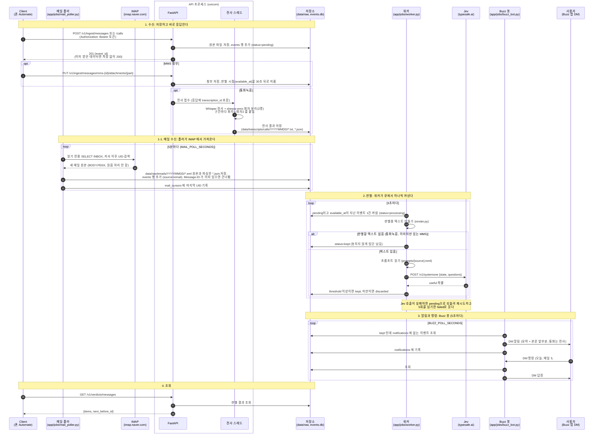

# 파이프라인 흐름

API와 메일 폴러는 받은 데이터를 저장만 한다. 판별은 별도 프로세스인 워커가 `events` 테이블을 큐처럼 꺼내 쓰며 나중에 처리한다.

| status | 뜻 |
|---|---|
| `pending` | 판별 대기 |
| `processing` | 워커가 판별 중 |
| `kept` | 쓸모 있음. 다음 단계(요약, 알림)로 넘길 대상 |
| `discarded` | 노이즈. 여기서 끝 |
| `failed` | 재시도를 다 써도 실패. 사람이 확인해야 함 |
